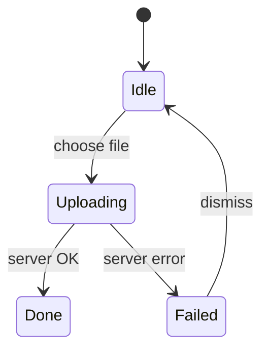

# Statechart

A state diagram is the fastest way to see whether code matches intent. Reading the diff shows how something was built; the diagram shows what the user can get into and out of, so a missing "cancel" or a state with no way out stands out at a glance.

Draw it from the **code**, not from the ticket. A diagram of what was asked for would only repeat the ticket; a diagram of what was built is what you compare against it.

## 1. Find the states the user can see

Read the feature's components, hooks, reducers or stores. A state is something the user can see and tell apart: "Uploading 40%", "Upload failed", "Empty list". Merge internal flags that look the same to the user, and split one variable that shows two different screens.

Ignore implementation detail such as memoisation or loading for a fraction of a second that never shows.

If parts of the feature change independently (a panel's open or closed state, what a status line says, which tab is selected), draw them as parallel regions inside one composite state, separated by `--`, instead of multiplying every combination into its own state.

## 2. Find the events and transitions

For each state, list what can move the user out of it:

- user actions (click, submit, cancel, close, back, retry);
- system events (response, error, timeout, offline, another device or tab, session expiry).

Note guards ("only if the form is valid") on the arrow. For each transition, record the file and line it comes from, so a reviewer can check it.

## 3. Draw it

Use Mermaid `stateDiagram-v2`, with user-facing names. Use nested states only when they make the diagram easier to read.

Every arrow must come from a line of code you can cite. When one handler connects every state in a group to every other (any tab to any tab), draw one representative arrow, and say in its table row that the same handler covers the rest, citing it. Don't draw arrows the intent asks for but the code lacks, and don't invent arrows to illustrate a problem (such as a self-loop labelled "no exit"); show problems by marking states instead. A reviewer should be able to trust that the diagram is what was built.

Mark problems in the diagram itself, so they are visible without reading the table: give dead-end and unreachable states a `classDef` (for example `classDef gap stroke:#c00,stroke-width:3px`) and a `note right of` saying what's wrong. Include arrows for system events that land somewhere surprising, such as a response arriving after the user cancelled.

Keep labels on one line: no `\n`, quotes or extra colons, which Mermaid renders literally or rejects.



## 4. Compare with the intent

Find the intent in the ticket, the PR description, the user's message, or ask. Then check:

- **Missing transitions**: things the intent asks for that have no arrow (cancel, retry, undo, back).
- **Dead ends**: states with no way out except reloading.
- **Unreachable states**: states in the code that no arrow leads to.
- **Unhandled events**: errors, timeouts, offline or concurrent changes that a state ignores.
- **Extra behaviour**: arrows the intent didn't ask for. Some are fine, but say so.

Before you report a gap, trace it through the code once more: which line sets the state, which event fires, and which lines clear or reset it on the way. Explanations of when something carries over (a stale error, a leftover value, a late response) are easy to get wrong from a first read, and a wrong explanation sends the fix to the wrong place. If you can't confirm the path, say it's unconfirmed.

Don't fix the code as part of this skill unless asked. The diagram and the gaps are the output; the user decides what to change.

## Report

```
## Statechart: [feature]
Source: [files]

[mermaid diagram]

| From | Event | To | Code |
|---|---|---|---|
| [state] | [user action or system event] | [state] | [file:line] |

| Gap | Kind | Where in code | Intent says |
|---|---|---|---|
| [e.g. no cancel while uploading] | missing transition | Upload.tsx:42 | "user can cancel an upload" |

Questions: [anything the intent doesn't settle]
```

Save the diagram next to the feature (for example `docs/statecharts/[feature].md`) if the user wants to keep it; reviewers can then compare it with the next change.
